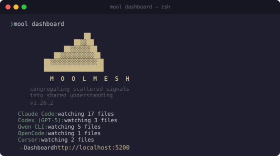

> [English version](README.md)

<p align="center">
  
</p>

# MoolMesh

**La malla de contexto para agentes autónomos.**

Observabilidad unificada, telemetría y coordinación entre agentes — ejecutándose completamente en tu máquina.

[](LICENSE)
[](https://python.org)
[](#desarrollo)
[](#)
[](https://pypi.org/project/moolmesh/)

---

## ¿Por qué MoolMesh?

El desarrollo de software moderno ya no es humano-contra-teclado. Es un ecosistema de agentes de IA trabajando en paralelo — cada uno con sus propios logs, contadores de tokens y trazas de razonamiento, todos encerrados en silos separados.

Cuando Claude Code se queda atrapado en un bucle, tus otros agentes no lo saben. Cuando gastas tokens en cuatro proveedores, no puedes ver qué commit lo justificó. Cuando tu equipo usa diferentes herramientas de IA en el mismo repositorio, nadie tiene la imagen completa.

**MoolMesh congrega lo que está disperso.** Auto-descubre sesiones de todos los agentes de programación con IA principales, las normaliza en una única base de datos consultable y expone ese estado tanto a humanos (vía dashboard) como a máquinas (vía MCP).

Lee nuestra [Filosofía](PHILOSOPHY.md) para entender el doble axioma detrás de MoolMesh: **Human-First y Agent-First**.

---

## Qué obtienes

Cuatro vistas en una sola pestaña del navegador:

| Vista | Qué muestra |
|-------|-------------|
| **AI Sessions** | Feed de eventos en vivo de todos los agentes — mensajes, llamadas a herramientas, uso de tokens, modelos |
| **Analytics** | Consumo de tokens por proveedor, actividad por hora, herramientas más usadas, proyectos principales |
| **Project Pulse** | Kanban de PRs, lista de issues, milestones, tablero de GitHub Projects v2 |
| **Code Timeline** | Feed de commits, estadisticas por autor, archivos calientes, resumenes diarios/semanales |

Además, un **servidor MCP** que permite a otros agentes de IA consultar los datos de sesión programáticamente — habilitando supervisión y orquestación entre agentes.

---

## Inicio rápido

### Instalar

**Requiere Python 3.11 o superior.** MoolMesh usa `match/case`, `tomllib` y otras funcionalidades que no existen en versiones anteriores. Python 3.10 llegó a fin de vida en octubre 2026.

```bash
# Recomendado — instalación aislada, comando global
pipx install moolmesh

# O con pip (dentro de un entorno virtual)
pip install moolmesh
```

> **Nota:** En Linux moderno (Ubuntu 22.04+, Debian 12+, Fedora 38+),
> `pip install` fuera de un entorno virtual está bloqueado por
> [PEP 668](https://peps.python.org/pep-0668/). Usa `pipx` en su lugar,
> o crea un venv primero:
> ```bash
> python3 -m venv ~/.venvs/moolmesh && source ~/.venvs/moolmesh/bin/activate
> pip install moolmesh
> ```

### Windows

```powershell
# Recomendado — maneja PATH y dependencias automáticamente
uv tool install moolmesh

# Alternativa
pipx install moolmesh

# O con pip (puede requerir agregar Scripts al PATH)
pip install moolmesh
```

Si `mool` no se encuentra después de instalar con pip, agrega el directorio Scripts a tu PATH:

```powershell
pip show -f moolmesh | findstr Scripts
$env:PATH += ";C:\Users\TuUsuario\AppData\Local\...\Scripts"
```

### Iniciar

```bash
# Primer plano (bloquea la terminal)
mool dashboard

# Daemon en background (recomendado — sigue corriendo al cerrar la terminal)
mool daemon start
# → abrir http://localhost:5200
```

El daemon funciona en todas las plataformas (macOS, Linux, Windows). Usa `mool daemon stop` para detenerlo, `mool daemon status` para verificar.

Eso es todo. MoolMesh auto-descubre tus sesiones de IA inmediatamente. No requiere configuración.

> **Ejecutar desde el código fuente:**
> ```bash
> git clone https://github.com/fmicalizzi/moolmesh.git
> cd moolmesh
>
> # macOS / Linux
> python3 -m venv .venv && source .venv/bin/activate
>
> # Windows (PowerShell)
> python -m venv .venv; .venv\Scripts\Activate.ps1
>
> pip install -e ".[dev]"
> mool dashboard
> ```

---

## Instalación en producción

Para acceso global (ejecutar `mool` desde cualquier directorio):

```bash
# Recomendado — venv aislado, binario global
pipx install moolmesh

# O con pip (requiere venv en Python moderno)
pip install moolmesh
```

### Actualizar

```bash
# pipx (recomendado)
pipx upgrade moolmesh --pip-args=--no-cache-dir

# pip dentro de un entorno virtual
python -m pip install --upgrade --no-cache-dir moolmesh

# uv tool
uv tool upgrade moolmesh
```

Después reiniciá el daemon para que corra la versión nueva:

```bash
mool daemon restart
```

`--no-cache-dir` omite la caché local de pip: justo después de un release, un wheel
cacheado (o un mirror atrasado) puede hacer que la actualización resuelva la versión
anterior.

Después de actualizar, reiniciá las sesiones de agentes abiertas (o sus servidores MCP)
para que carguen el código nuevo; `mool doctor` lista los desactualizados (1.26.2+).
Cada sesión de agente mantiene vivo su propio `hub.mcp_server` hasta que se cierra, así
que sigue sirviendo la versión vieja después de actualizar y de `mool daemon restart`.
Los servidores iniciados por 1.26.1 o anteriores no pueden avisar que están
desactualizados y no aparecen en la lista: solo un reinicio los reemplaza.

**Usuarios de OpenCode:** después de actualizar a 1.27.1, corré
`mool backfill --reparse opencode` (una simulación que no escribe nada) y luego
`mool backfill --reparse opencode --yes` para recuperar las respuestas, el
razonamiento y el detalle de las herramientas que las versiones anteriores guardaron
sin texto (antes se hace un backup de events.db).

**Windows:** un daemon en ejecución puede bloquear archivos dentro del venv de pipx y
hacer que `pipx upgrade` falle o se aplique a medias: detenelo antes
(`mool daemon stop`), actualizá y luego `mool daemon start`. Si instalaste con Scoop u
otro gestor, usá su propia actualización (`scoop update moolmesh`,
`uv tool upgrade moolmesh`).

### Servicio systemd (Linux)

Usa `mool dashboard` (foreground) como punto de entrada — MoolMesh auto-detecta systemd y se queda en primer plano:

```ini
# ~/.config/systemd/user/moolmesh.service
[Unit]
Description=MoolMesh Dashboard
After=network.target

[Service]
Type=simple
ExecStart=%h/.local/bin/mool daemon start --port 5200
Restart=on-failure
RestartSec=5

[Install]
WantedBy=default.target
```

```bash
systemctl --user daemon-reload
systemctl --user enable --now moolmesh
systemctl --user status moolmesh
```

> **Nota:** `mool daemon start` auto-detecta systemd (`$INVOCATION_ID`) y se queda en primer plano, así `Type=simple` funciona correctamente. Fuera de systemd, hace double-fork como siempre.

---

## Agentes soportados

| Proveedor | Fuente de sesión | Formato |
|-----------|-----------------|---------|
| **Claude Code** | `~/.claude/projects/` | JSONL por sesión + logs de subagentes |
| **Codex (GPT-5)** | `~/.codex/sessions/` + `state_5.sqlite` | Rollout JSONL + metadatos SQLite |
| **Qwen CLI** | `~/.qwen/projects/` | JSONL por chat |
| **OpenCode** | `~/.local/share/opencode/opencode.db` | SQLite (sesion → mensaje → parte) |
| **Cursor** | `~/Library/Application Support/Cursor/User/` (macOS) | SQLite (`state.vscdb` clave-valor: bubbles del composer) |
| **Antigravity CLI** | `~/.gemini/antigravity-cli/` (`$ANTIGRAVITY_APP_DATA_DIR`) | JSONL de transcript por conversación + índice SQLite de sesiones (solo lectura) |

Las sesiones se auto-descubren al iniciar. Sin configuración, sin claves API, sin servicios en la nube.

---

## Integracion con Git y GitHub

Registra un repositorio git para desbloquear Project Pulse y Code Timeline:

```bash
cd /path/to/your/repo
mool repo add                            # Registra el directorio actual
```

Esto ingesta el historial de commits y comienza a consultar GitHub para issues, PRs, milestones y Projects v2.

```bash
mool repo list                           # Mostrar repos registrados
mool repo remove                         # Desregistrar el repo actual
mool repo sync --all                     # Re-ingestar historial completo
```

Todos los subcomandos de `repo` usan el directorio actual cuando no se especifica una ruta.

### Token de GitHub

El token se resuelve automáticamente en este orden:

1. `gh auth token` (GitHub CLI — recomendado)
2. Variable de entorno `GITHUB_TOKEN`
3. `~/.moolmesh/config.toml` → `[github] token = "..."`

Para **repos públicos**, no se necesita token — el historial de commits funciona sin acceso a la API de GitHub.

Para **repos privados**, se requiere un token con scope `repo`. La forma más fácil:

```bash
gh auth login                            # Seguir los prompts, seleccionar scope repo
```

Si no tenés GitHub CLI, configurá la variable de entorno o agregalo al config:

```toml
# ~/.moolmesh/config.toml
[github]
token = "ghp_xxxxxxxxxxxxxxxxxxxx"
```

Sin un token válido, `mool repo add` funciona igual — ingesta el historial local de git, pero Project Pulse (issues, PRs, milestones) no tendrá datos de GitHub.

---

## Servidor MCP (API inter-agentes)

MoolMesh expone un servidor MCP de solo lectura vía stdio, permitiendo que cualquier agente compatible con MCP consulte los datos de sesión.

El servidor MCP usa [PEP 723](https://peps.python.org/pep-0723/) (inline script metadata) para sus dependencias (el paquete `mcp`). Esto mantiene MoolMesh con cero dependencias externas mientras permite que el servidor MCP funcione de forma independiente.

### Configuración rápida

```bash
mool mcp setup                  # Claude Code (global, scope usuario)
mool mcp setup claude-desktop   # Claude Desktop (macOS/Linux/Windows)
mool mcp setup cursor           # Cursor IDE
mool mcp setup codex            # Codex (OpenAI CLI)
mool mcp setup qwen             # Qwen CLI
mool mcp setup opencode         # OpenCode
mool mcp setup json             # Imprimir JSON para cualquier cliente MCP
```

El comando auto-detecta el método de instalación (pipx / uv tool / pip / venv), encuentra las rutas correctas de Python y del servidor, y verifica la dependencia `mcp`. Si `mcp` no está instalado, muestra el comando exacto, o usa `--install-deps` para instalarlo automáticamente:

```bash
mool mcp setup --install-deps
```

`--install-deps` instala `mcp>=1.2.0,<2` (la cota importa: `mcp` 2.x es incompatible) de la forma que requiere tu método de instalación:

| Instalado con | `--install-deps` ejecuta |
|---------------|--------------------------|
| `pipx install moolmesh` | `pipx inject moolmesh "mcp>=1.2.0,<2"` |
| `uv tool install moolmesh` | `uv pip install --python <python del tool> "mcp>=1.2.0,<2"` |
| `pip install moolmesh` (venv o sistema) | `<python> -m pip install "mcp>=1.2.0,<2"` |

Los entornos de `uv tool` no traen pip, así que `python -m pip` no funciona en ellos. Si `uv` no está en tu `PATH`, reinstala incluyendo la dependencia: `uv tool install --with "mcp>=1.2.0,<2" moolmesh --force`.

Usa `--dry-run` para previsualizar sin cambiar nada: con Claude Code imprime los comandos `claude mcp remove` / `claude mcp add` que ejecutaría (nunca los ejecuta), y con los otros clientes la configuración que escribiría.

### Configuración manual

Si preferís configurar manualmente, apuntá el cliente al intérprete Python del
entorno donde está instalado MoolMesh (y `mcp`), y ejecutá el servidor como módulo
(requiere `mcp>=1.2.0,<2` en ese entorno, p. ej. `pipx inject moolmesh "mcp>=1.2.0,<2"`
o `uv pip install --python /ruta/a/python "mcp>=1.2.0,<2"`):

```json
{
  "mcpServers": {
    "moolmesh": {
      "command": "/ruta/a/pipx/venvs/moolmesh/bin/python",
      "args": ["-m", "hub.mcp_server"]
    }
  }
}
```

En Windows el intérprete es `...\Scripts\python.exe`. No uses
`uv run /ruta/a/hub/mcp_server.py`: ejecuta el script en un entorno aislado sin el
paquete `hub` y falla con `No module named 'hub'`.

### Herramientas disponibles

| Herramienta | Descripción |
|-------------|-------------|
| `get_recent_events` | Últimos N eventos de todos los proveedores |
| `get_active_sessions` | Sesiones activas en las últimas N horas |
| `get_token_usage` | Consumo de tokens por proveedor |
| `get_tool_stats` | Herramientas más usadas por los agentes de IA |
| `search_events` | Búsqueda de texto completo en resúmenes de eventos |
| `get_project_activity` | Resumen completo del proyecto con estadísticas |
| `get_server_info` | Versión en ejecución vs instalada de este servidor MCP — llamala si los resultados parecen inconsistentes: un servidor desactualizado hay que reiniciarlo |

Recursos: `hub://schema` (esquema de base de datos), `hub://projects` (lista de proyectos con estadísticas).

El servidor abre SQLite en modo solo lectura (`?mode=ro`). Se ejecuta como un proceso separado (~15-20 MB RAM), independiente del dashboard.

Un servidor más viejo que la versión instalada lo dice: `get_server_info` devuelve
`stale: true`, las herramientas que devuelven un objeto agregan la clave `stale_server`
y la primera detección queda registrada una vez en el log. Además cada servidor se
anota en `~/.moolmesh/run/mcp-<pid>.json` (se borra al salir) para que `mool doctor`
liste los que corren código viejo — es estado propio de MoolMesh, no datos de proveedores.

---

## Resúmenes narrativos (Digests)

Code Timeline genera resúmenes diarios y semanales para cada repositorio registrado:

| Nivel | Qué contiene | Cuándo |
|-------|-------------|--------|
| **L1** | Estadísticas SQL crudas (commits, PRs, issues, LOC) | Siempre disponible |
| **L2** | Plantilla estructurada con puntos clave | Siempre disponible |
| **L3** | Párrafo narrativo generado por LLM | Cuando hay un proveedor LLM configurado |

L3 funciona con cualquier API compatible con OpenAI. Configura en `~/.moolmesh/config.toml`:

```toml
[llm]
provider = "openrouter"
api_url  = "https://openrouter.ai/api/v1"
model    = "google/gemma-4-31b-it:free"
api_key  = "sk-or-v1-..."
```

Proveedores soportados: OpenRouter, OpenAI, Together, Groq, Ollama. Si el LLM no está disponible, los resúmenes caen automáticamente a L2.

---

## Reportes por lotes

Genera reportes de análisis en Markdown desde la línea de comandos:

```bash
# Reporte automático — escribe en ~/.moolmesh/reports/
mool report auto

# Contenido completo (sin truncar)
mool report auto --complete

# Filtrar por proyecto o proveedor
mool report --project myapp --provider claude --output ./exports
```

---

## Referencia del CLI

```
mool <comando> [opciones]

Comandos:
  dashboard              Iniciar el dashboard de monitoreo en vivo
  daemon start           Ejecutar el dashboard como servicio en background
  daemon stop            Detener el servicio en background
  daemon status          Mostrar PID, uptime, tamaño de log
  daemon restart         Reiniciar el servicio en background
  status [--json]        Atajo rápido para daemon status
  mcp setup [TARGET]     Configurar servidor MCP (claude-code|claude-desktop|cursor|codex|qwen|opencode|json)
  doctor                 Ejecutar diagnóstico del sistema
  install                Instalar comando mool globalmente (~/.local/bin)
  report                 Generar reportes de análisis en Markdown por lotes
  discover [--json]      Listar todos los proyectos de agentes de IA descubiertos
  repo add [PATH]        Registrar un repositorio git (por defecto: directorio actual)
  repo list              Listar repos registrados con conteo de commits
  repo remove [PATH]     Desregistrar un repositorio (por defecto: directorio actual)
  repo sync [PATH]       Re-ingestar historial de commits
  query events           Eventos recientes como JSON
  query sessions         Sesiones activas como JSON
  query tokens           Uso de tokens por proveedor como JSON
  query tools            Herramientas más usadas como JSON
  query search TEXTO     Buscar eventos por texto como JSON
  query project NOMBRE   Resumen de actividad de un proyecto como JSON

Opciones globales:
  --version              Mostrar versión y salir

Opciones del dashboard / daemon:
  --port PORT            Puerto del servidor (por defecto: 5200)
  --host HOST            Host del servidor (por defecto: localhost)
  --project NAME         Filtrar por nombre de proyecto
  --providers LIST       Separados por coma: claude,codex,qwen,opencode,cursor,pi,antigravity

Opciones de reportes:
  --complete             Modo contenido completo: sin truncar
  --output DIR           Directorio de salida
  --provider PROVIDER    Filtrar por proveedor
```

### CLI para agentes (`mool query`)

Para agentes sin soporte MCP, `mool query` expone los mismos datos del servidor MCP via JSON en stdout:

```bash
# Últimos 10 eventos
mool query events -n 10

# Sesiones activas en las últimas 2 horas
mool query sessions --hours 2

# Consumo de tokens por proveedor desde una fecha
mool query tokens --since 2026-06-01

# Herramientas más usadas en un proyecto
mool query tools --project moolmesh -n 5

# Buscar eventos que mencionen "daemon"
mool query search "daemon" --provider claude

# Resumen completo de actividad de un proyecto
mool query project moolmesh
```

Toda la salida es JSON válido — compatible con `jq`, parseable en cualquier lenguaje, o usable desde llamadas subprocess de agentes. También: `mool status --json` y `mool discover --json` para salida parseable por máquinas.

### Endpoint de salud

Cuando el dashboard está corriendo, `GET /health` retorna:

```json
{"status": "healthy", "version": "1.4.0", "uptime_seconds": 3600, "events_count": 45231}
```

---

## Arquitectura

```
hub/
  parsers/         Parsers JSONL + SQLite para cada proveedor
  adapters/        Normalizar entradas del proveedor → eventos unificados
  watchers/        Cosechadores de archivos: descubrir → offset → parsear → almacenar → SSE
  harvesters/      GitHarvester (120s) + GitHubHarvester (15s/60s)
  integrations/    GitHubClient (REST + GraphQL) + clientes LLM
  digests/         L1 Stats → L2 Plantilla → L3 Narrativa LLM
  correlation/     Enlaces AI ↔ Git: Co-Author, refs a issues, timestamps
  dashboard/       Servidor HTTP + SSE + 4 paginas HTML
  cache/           EventStore (events.db) + GitStore (github.db)
  mcp_server.py    Servidor MCP stdio (solo lectura, PEP 723 deps inline)
  cli.py           Punto de entrada del CLI
```

### Flujo de datos

1. **Discovery** escanea los directorios de cada proveedor buscando archivos de sesion
2. **Parsers** leen JSONL o consultan SQLite generando entradas tipadas
3. **Adapters** normalizan a `UnifiedEvent` con campos comunes
4. **Watchers** hacen polling incremental, almacenan atomicamente en SQLite y envian via SSE
5. **Dashboard** sirve el feed en vivo + analytics via HTTP + Server-Sent Events

Todo el estado se persiste en SQLite. Seguro ante crashes, semantica exactly-once via offsets transaccionales.

---

## Persistencia

| Base de datos | Ruta | Contenido |
|---------------|------|-----------|
| `events.db` | `~/.moolmesh/events.db` | Eventos de sesiones de IA, offsets de archivos, búfer de replay SSE |
| `github.db` | `~/.moolmesh/github.db` | Repos, commits, issues, PRs, milestones, resúmenes |

Ambas bases de datos se crean automáticamente. El esquema migra al iniciar.

---

## Confiabilidad

- **SSE sin brechas** — los campos `id:` habilitan reconexion del navegador con replay desde SQLite
- **Offsets transaccionales** — eventos y posiciones de archivo se actualizan en una sola transaccion
- **Seguridad ante crashes de Git** — excepciones capturadas por repositorio, timeout de 60s en `git fetch`
- **ETags de GitHub** — las respuestas 304 no consumen rate limit
- **Fallback de resúmenes** — LLM no disponible → plantilla L2, sin repos → estadísticas L1
- **Seguridad WAL de OpenCode** — SQLite solo lectura con timeout, nunca bloquea escrituras de OpenCode

---

## Hoja de ruta

MoolMesh empezó con agentes de programación, pero la visión es más amplia — cualquier agente autónomo que genere señales observables pertenece a la malla.

| Estado | Versión | Alcance |
|--------|---------|---------|
| **Entregado** | v1.6 | 4 proveedores (Claude, Codex, Qwen, OpenCode), metadata de sesiones, export de transcripts, búsqueda full-text, correlación por branch, vinculación cruzada de sesiones |
| **Planeado** | v1.7 | Nuevos proveedores: Aider, GitHub Copilot CLI, Pi |
| **Planeado** | v1.8 | Template de proveedor y guía de contribución |
| **Futuro** | v2.0 | Soporte para agentes autónomos: Hermes, Odyssey, Goose |
| **Visión** | v2.x | Observabilidad a nivel organización, multi-usuario, analytics cross-repo |

Consulta [ROADMAP.md](ROADMAP.md) para planes detallados, preguntas abiertas y principios de diseño.

---

## Limitaciones

- **Óptimo en macOS, compatible con Linux** — macOS usa `kqueue` para detección instantánea; Linux usa polling (~1s)
- **Sin autenticación** — el dashboard se vincula a localhost. Usa un proxy inverso para acceso remoto
- **Diseño mono-usuario** — no está pensado para despliegues multi-usuario o en servidor
- **Python 3.11+** — utiliza `tomllib` de la biblioteca estandar
- **Solo GitHub Projects v2** — Projects clasicos (v1) no estan soportados
- **Limitaciones de Cursor** — Cursor no guarda timestamps por mensaje localmente (MoolMesh los aproxima desde la metadata del composer) y su esquema en disco es reverse-engineered, por lo que una actualización de Cursor puede reducir temporalmente la ingesta hasta ajustar el parser
- **Limitaciones de Antigravity** — solo se observa el CLI (`agy`), no la app de escritorio ni el IDE; no se leen modelo, tokens, costo ni branch de git (el transcript no los trae de forma confiable), y el formato en disco no es una API documentada y el CLI publica varias versiones por semana, por lo que una actualización puede reducir temporalmente la ingesta hasta ajustar el parser (detalles en `docs/PROVIDERS.md`)

---

## Desarrollo

```bash
# Ejecutar todos los tests
pytest tests/ -v

# Ejecutar con cobertura
pytest tests/ -v --cov=hub
```

1787 tests. Cero dependencias externas. Python stdlib + SQLite.

Consulta [CONTRIBUTING.md](CONTRIBUTING.md) para las guías de contribución.

---

## Licencia

[MIT](LICENSE) — Tu telemetria es tuya.
