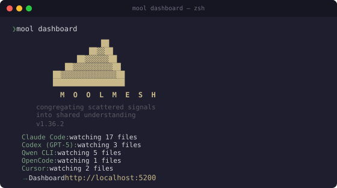

<p align="center">
  
</p>

# MoolMesh

**The context mesh for autonomous agents.**

Unified observability, telemetry, and inter-agent coordination — running entirely on your machine.

[](LICENSE)
[](https://python.org)
[](#development)
[](#)
[](https://pypi.org/project/moolmesh/)
[](README.es.md)

---

## Why MoolMesh?

Modern software development isn't human-to-keyboard anymore. It's an ecosystem of AI agents working in parallel — each with its own logs, token counters, and reasoning traces, all locked in separate silos.

When Claude Code gets stuck in a loop, your other agents don't know. When you spend tokens across several providers, you can't see which git commit justified it. When your team uses different AI tools on the same repo, nobody has the full picture.

**MoolMesh congregates what is scattered.** It auto-discovers sessions from every major AI coding agent, normalizes them into a single queryable database, and exposes that state to both humans (via a dashboard) and machines (via MCP).

Read our [Philosophy](PHILOSOPHY.md) to understand the dual axiom behind MoolMesh: **Human-First & Agent-First**.

---

## What You Get

Four views in a single browser tab:

| View | What it shows |
|------|---------------|
| **AI Sessions** | Live event feed from all agents — messages, tool calls, token usage, models |
| **Analytics** | Token consumption by provider, hourly activity, top tools, top projects |
| **Project Pulse** | PR kanban, issues list, milestones, GitHub Projects v2 board |
| **Code Timeline** | Commit feed, author stats, hot files, daily/weekly digest narratives |

Plus a **MCP server** that lets other AI agents query your session data programmatically — enabling agent-to-agent supervision and orchestration.

---

## Quick Start

### Install

**Requires Python 3.11 or later.** MoolMesh uses `match/case`, `tomllib`, and other features that don't exist in earlier versions. Python 3.10 reached end-of-life in October 2026.

```bash
# Recommended — isolated install, global command
pipx install moolmesh

# Or with pip (inside a virtual environment)
pip install moolmesh
```

> **Note:** On modern Linux (Ubuntu 22.04+, Debian 12+, Fedora 38+),
> `pip install` outside a virtual environment is blocked by
> [PEP 668](https://peps.python.org/pep-0668/). Use `pipx` instead,
> or create a venv first:
> ```bash
> python3 -m venv ~/.venvs/moolmesh && source ~/.venvs/moolmesh/bin/activate
> pip install moolmesh
> ```

### Windows

```powershell
# Recommended — handles PATH and dependencies automatically
uv tool install moolmesh

# Alternative
pipx install moolmesh

# Or with pip (may need to add Scripts to PATH)
pip install moolmesh
```

If `mool` is not found after installing with pip, add the Scripts directory to your PATH:

```powershell
pip show -f moolmesh | findstr Scripts
$env:PATH += ";C:\Users\YourUser\AppData\Local\...\Scripts"
```

### Start

```bash
# Foreground (blocks the terminal)
mool dashboard

# Background daemon (recommended — keeps running after you close the terminal)
mool daemon start
# → open http://localhost:5200
```

The daemon runs on all platforms (macOS, Linux, Windows). Use `mool daemon stop` to stop it, `mool daemon status` to check.

That's it. MoolMesh auto-discovers your AI sessions immediately. No configuration needed.

> **Running from source:**
> ```bash
> git clone https://github.com/fmicalizzi/moolmesh.git
> cd moolmesh
>
> # macOS / Linux
> python3 -m venv .venv && source .venv/bin/activate
>
> # Windows (PowerShell)
> python -m venv .venv; .venv\Scripts\Activate.ps1
>
> pip install -e ".[dev]"
> mool dashboard
> ```

### Run at login

`mool daemon start` does not survive a reboot. To have the daemon come back on
its own, register it with your OS supervisor (opt-in, nothing is installed by
default):

```bash
mool daemon install            # register + start now (localhost:5200)
mool daemon install --host 0.0.0.0 --port 5200
mool daemon install --dry-run  # print the file and commands, change nothing
mool daemon uninstall          # remove exactly what install created
```

| OS | Mechanism | File |
|----|-----------|------|
| macOS | LaunchAgent, label `dev.moolmesh.daemon` (`launchctl bootstrap gui/<uid>`; falls back to `load -w`) | `~/Library/LaunchAgents/dev.moolmesh.daemon.plist` |
| Linux | systemd `--user` unit (`Restart=on-failure`, logs in `journalctl --user -u moolmesh.service`) | `~/.config/systemd/user/moolmesh.service` |
| Windows | Task Scheduler task `MoolMesh` at logon, with `pythonw.exe` (no console) | record in `~/.moolmesh/autostart-task.json` |

- The supervised process always runs `python -m hub.cli daemon start --foreground`
  with the interpreter you installed from, and the `PATH` of the install moment
  (launchd and systemd start with a minimal one; without `gh` on it the GitHub
  sync would lose its token). Reinstalled or moved MoolMesh? Run
  `mool daemon install` again — `mool doctor` flags a registration whose
  interpreter no longer exists.
- With the autostart installed, `mool daemon start|stop|restart` go through the
  supervisor (`systemctl --user …`, `launchctl kickstart/kill`, `schtasks /Run`),
  so there is never a second daemon next to the supervised one.
- `install` never overwrites a file it did not create (e.g. a hand-written
  `moolmesh.service`): it exits 1 and shows the diff. `--force` replaces it after
  saving a `.bak-<date>` copy (for launchd the copy goes to `~/.moolmesh/`).
- **Linux:** without *linger* a user unit only starts after you log in.
  `install` checks `loginctl show-user "$USER" -p Linger` and, if it is off,
  tells you to run `loginctl enable-linger "$USER"` (it never runs it for you).

**Stale data.** MCP tools that read the portfolio (`get_portfolio_grouped`,
`get_portfolio_production`) and `get_server_info` carry a `freshness` block —
`daemon_running`, `last_git_sync_at`, `last_github_sync_at`, `repos_stale`,
`last_ingest_at`, `data_age_seconds`, `stale` — plus a top-level `stale: true`
when the daemon is down or the last git / GitHub API sync is older than
`[daemon] stale_after_minutes` (default 60) in `~/.moolmesh/config.toml`. The
dashboard shows a banner on every page in that case, and `mool doctor` prints a
freshness line. `daemon.log` is rotated to `daemon.log.1` past 10 MB.

**Storage bounds.** The full text stored per event (a tool's output, a long
message) is capped at `[daemon] full_text_max_chars` characters (default
256000; `0` = no cap): over it MoolMesh keeps the head and the tail around a
`[… N caracteres omitidos por MoolMesh …]` marker, so a 20 MB tool output can no
longer bloat `events.db`. The cap applies to new rows; text stored earlier is
left as is.

**History is history on any path.** An event whose own time is older than the
12 h live window when MoolMesh first reads it is stored as history
(`events.historical = 1`), whether it came from the live watcher, the startup
catch-up or `mool backfill`: the first read of an OpenCode or Cursor database
(months of sessions) no longer floods the live feed and SSE, and the lines a
resumed Claude session replays with their original dates stay out of "recent";
its new messages are live as usual.

**Backups.** Before rewriting existing rows, migrations and `mool backfill
--reparse` copy the database to `~/.moolmesh/backups/`; only the newest 5
`events-*` and 5 `workspace-*` copies are kept (older ones are deleted after
each new backup, never the one just made).

**Local day.** Digests, the workspace rollup and `get_portfolio_production`
share one definition of "which day": the zone in `[user] timezone` (an IANA
name such as `"America/Costa_Rica"`; unset = the system zone; an unknown name
falls back to the system zone with a warning in the log). A PR merged at 01:00
UTC is in the previous day's digest at UTC-6. `get_portfolio_production(days)`
returns `merged_prs_window` and `closed_issues_window` (merged / closed on a
local day of the window) next to the all-time `merged_prs` and `closed_issues`.

**Days worked.** The production strip counts a session on every local day it
had events on a project, not only on its last one: a session resumed over three
days lights three days. Each day counts distinct sessions; `sessions` counts
distinct sessions in the window (never the sum of the days) and `active_days`
the distinct days. The days live in `workspace.db` (`edge_active_days`). The
first daemon pass after the upgrade fills them from `events.db`, after a backup
of `workspace.db`; changing `[user] timezone` re-derives them the same way. A
session whose events are no longer in `events.db` is dated by its last event,
as before.

The rollup views (`get_portfolio`, `get_portfolio_grouped` and its client tier,
`mool workspace portfolio`, the `/portfolio` rows) carry the same figures next
to the touches, additively: `sessions_worked` (distinct sessions) and
`days_worked` (distinct local days) in the window — a client unions the
sessions and days of its projects, so a session shared by two projects counts
once. `days_worked_basis` says where they came from: `edge_active_days`, or
`rollup` when the table is missing or bucketed in another zone (then
`days_worked` is `active_days` and `sessions_worked` is `null`).
`session_touches` and `active_days` keep their meaning. The CLI shows
`Nd (Nd/Mses worked)`.

---

## Updating

```bash
# pipx (recommended)
pipx upgrade moolmesh --pip-args=--no-cache-dir

# pip inside a virtual environment
python -m pip install --upgrade --no-cache-dir moolmesh

# uv tool
uv tool upgrade moolmesh
```

Then restart the daemon so it runs the new version:

```bash
mool daemon restart
```

`--no-cache-dir` skips the local pip cache: right after a release, a cached
wheel (or a lagging mirror) can make the upgrade resolve the previous version.

After upgrading, restart open agent sessions (or their MCP servers) so they load
the new code; `mool doctor` lists stale ones (1.26.2+). Every agent session keeps
its own `hub.mcp_server` alive until it closes, so it keeps serving the old
version after the upgrade and `mool daemon restart`. Servers started by 1.26.1 or
earlier can't report that they are stale and are not listed — only a restart
replaces them.

**OpenCode users:** after upgrading to 1.27.1, run `mool backfill --reparse opencode`
(a simulation that writes nothing) and then `mool backfill --reparse opencode --yes`
to recover the replies, reasoning and tool details that earlier versions stored
without their text (events.db is backed up first).

**Windows:** a running daemon can lock files inside the pipx venv and make
`pipx upgrade` fail or apply only partially — stop it first
(`mool daemon stop`), upgrade, then `mool daemon start`. If you installed with
Scoop or another tool manager, use its own upgrade (`scoop update moolmesh`,
`uv tool upgrade moolmesh`).

---

## Production Install

For system-wide access (run `mool` from any directory):

```bash
# Recommended — isolated venv, global binary
pipx install moolmesh

# Or with pip (requires a venv on modern Python)
pip install moolmesh
```

### systemd service (Linux)

`mool daemon install` (see [Run at login](#run-at-login)) writes and manages this unit for you; the manual unit below is still supported.

`mool daemon start` works as a foreground entry point — MoolMesh auto-detects systemd and skips the double-fork:

```ini
# ~/.config/systemd/user/moolmesh.service
[Unit]
Description=MoolMesh Dashboard
After=network.target

[Service]
Type=simple
ExecStart=%h/.local/bin/mool daemon start --port 5200
Restart=always
RestartSec=5

[Install]
WantedBy=default.target
```

```bash
systemctl --user daemon-reload
systemctl --user enable --now moolmesh
systemctl --user status moolmesh
```

> **Why `Restart=always`:** according to `systemd.service(5)`, `SIGHUP`, `SIGINT`, `SIGTERM` and `SIGPIPE` count as a *clean* exit, and `Restart=on-failure` only revives non-zero exits or unclean signals. So with `Restart=on-failure` a `kill -TERM` — including a `mool daemon stop` from outside — would never be revived, whatever the exit code. `Restart=always` revives the dashboard after any exit; `systemctl --user stop moolmesh` still stops it for good, because systemd never restarts a service it stopped itself.
>
> `Restart=on-failure` remains a valid choice if you only want real failures revived: `mool daemon start`/`mool dashboard` exit 1 when they cannot start (port already in use, another MoolMesh on the port), and a supervised run never silently moves to the next port. But a terminated process will stay down until you start it again.
>
> **Note:** `mool daemon start` auto-detects systemd (`$INVOCATION_ID`) and stays in the foreground, so `Type=simple` works correctly. Outside systemd, it double-forks as usual; `--foreground` forces the same behavior without the environment marker. When managed by systemd, use `systemctl --user stop/restart moolmesh` instead of `mool daemon stop/restart` — MoolMesh warns, but it cannot restart the unit for you.

---

## Supported Agents

| Provider | Session source | Format |
|----------|---------------|--------|
| **Claude Code** | `~/.claude/projects/` | JSONL per session + subagent logs |
| **Codex (GPT-5)** | `~/.codex/sessions/` + `state_5.sqlite` | Rollout JSONL + SQLite metadata |
| **Qwen CLI** | `~/.qwen/projects/` | JSONL per chat |
| **OpenCode** | `~/.local/share/opencode/opencode.db` | SQLite (session → message → part) |
| **Cursor** | `~/Library/Application Support/Cursor/User/` (macOS) | SQLite (`state.vscdb` key-value: composer bubbles) |
| **Pi** | `~/.pi/agent/sessions/` (`$PI_CODING_AGENT_DIR`) | JSONL session tree per session |
| **Antigravity CLI** | `~/.gemini/antigravity-cli/` (`$ANTIGRAVITY_APP_DATA_DIR`) | JSONL transcript per conversation + SQLite session index (read-only) |

Sessions are auto-discovered on startup. No configuration, no API keys, no cloud services.

---

## Git & GitHub Integration

Register a git repository to unlock Project Pulse and Code Timeline:

```bash
cd /path/to/your/repo
mool repo add                            # Registers the current directory
mool repo add --remote acme/widgets      # No clone: issues, PRs and PR stats only
mool repo add --owner acme --dry-run     # Every repo of an org or user, as remote
```

This ingests commit history and starts polling GitHub for issues, PRs, milestones, and Projects v2.

```bash
mool repo list                           # Show registered repos
mool repo remove                         # Unregister current repo
mool repo sync --all                     # Re-ingest full history
mool repo backfill-pr-stats --all-registered --limit 200   # +/-, files, closed issues of older PRs
```

All `repo` subcommands default to the current directory when no path is given.

**Per-PR stats:** the GitHub poll also stores, for each new or updated PR, its additions, deletions, changed files and the issues it closes (`closingIssuesReferences`, qualified as `owner/repo#n` — a PR can close issues in other repos). One GraphQL call covers up to 25 PRs, at most 50 PRs per poll; if the call fails the sync continues and the PR stays without stats. PRs cached before the upgrade (or past the per-poll cap) are filled with `mool repo backfill-pr-stats [PATH | --all-registered] [--limit N]` — bounded and resumable, it only asks for PRs still missing stats. The dashboard's PR pipeline (`/api/github/prs`) carries `additions`, `deletions`, `changed_files` and `closes`.

**Versioned snapshot export:** `mool snapshot export --repo OWNER/REPO --since YYYY-MM-DD --until YYYY-MM-DD [--format json] [--output FILE]` prints one repo's snapshot for a range of local days (`[user] timezone`): issues opened and closed in the period, totals at the cut, merged PRs with their stats (+/-, files, `closes` as `owner/repo#n`) and a `freshness` field — a stable, documented contract ([`docs/schema/snapshot.v1.md`](docs/schema/snapshot.v1.md), `schema_version` `1.0`) for tools that build on MoolMesh. Two exports of the same range are byte-identical (no generation time in the body); `--output` writes atomically. A range the repo's last GitHub sync does not cover (e.g. one that includes today) is refused with exit 3 unless `--allow-incomplete`, which marks it `freshness.complete = false`. Agents get the same payload from the MCP tool `get_snapshot(repo, since, until, allow_incomplete)`. It reads only `github.db` (no new API calls) and excluded repos answer as unregistered.

**Board repos (issues-only backlogs):** a repo used only as an issue backlog, with no code, is registered as a board — `mool repo add --board acme/backlog` (no local clone needed; a local clone path also works). In `config.toml` that is `kind = "board"` on its `[[repos]]` entry (default `"code"`, today's behaviour; a hand edit is picked up when the daemon restarts). A board runs no `git fetch` and no commit ingestion, only the GitHub issues sync (the same calls as any repo — no new API calls). The portfolio shows it as `board · N abiertas · M cerradas` instead of "0 entregado" and leaves it out of the merged-PR ranking. Agents read the backlog with the MCP tool `get_board_issues(repo, state, label, assignee, min_age_days, max_age_days, days, limit)`: issues filtered by label, assignee and age, plus the issues opened and closed on a local day of the last `days` days (`[user] timezone`) and the open backlog by label. It works on code repos too.

**Remote-only repos (no local clone):** a code repo you follow only through GitHub is registered with `mool repo add --remote acme/widgets` — no clone and no git history; its issues, PRs and per-PR stats are synced like any code repo (`kind = "remote"` in `config.toml`, keyed `remote:github.com/acme/widgets`; `--all` also backfills every issue/PR now). A board stays distinct: a board is a backlog, a remote repo is code whose merged PRs are the delivery. To follow a whole organization **or personal account**: `mool repo add --owner acme [--include 'widget*' ...] [--dry-run] [--limit N]` lists its repos (paginated, at most `--limit`, default 300; the listing stops early when fewer than 100 API calls are left in the hour) and registers each one as remote; `--dry-run` only lists. The portfolio shows a remote repo with GitHub activity in the window as `sin clon` — never "0 entregado" for lack of commits; its merged PRs count as delivery. **Identity is the numeric GitHub id** (github.db migration 8, additive `repos.github_id`): the daemon checks each registered repo with one `GET /repos/{owner}/{repo}` at most every 6 h (an ETag makes an unchanged repo a 304, which does not count against the rate limit; a repo with no id yet is retried every 10 min), and when GitHub answers with a new `owner/name` for the same id — a transfer or a rename — the existing row and config entry are updated, so the issues/PRs series keeps its history; `repo add --remote`/`--owner` with the new name renames instead of duplicating. `repo remove`, `repo sync` and `get_board_issues` accept `owner/repo` for a clone-less repo.

### GitHub token

A token is resolved automatically in this order:

1. `gh auth token` (GitHub CLI — recommended)
2. `GITHUB_TOKEN` environment variable
3. `~/.moolmesh/config.toml` → `[github] token = "..."`

For **public repos**, no token is needed — commit history works without GitHub API access.

For **private repos**, a token with `repo` scope is required. The easiest way:

```bash
gh auth login                            # Follow prompts, select repo scope
```

If you don't have the GitHub CLI, set the env var or add it to config:

```toml
# ~/.moolmesh/config.toml
[github]
token = "ghp_xxxxxxxxxxxxxxxxxxxx"
```

Without a valid token, `mool repo add` still works — it ingests local git history, but Project Pulse (issues, PRs, milestones) won't have GitHub data.

---

## Workspace (observe the work, not just the sessions)

A session's directory name is not the project it worked on. The **Workspace axis** attributes every file-touch to the project that *owns the file* — recovering the real multi-project (M:N) picture, and making a folder visible even before or without any agent (VISION §6).

**Attribute agent work you've already captured** — a read-only pass over `events.db` that maps each absolute `file_path` to its owning workspace (identity ladder `git-remote → git-root → path-hash`, so it survives rename/move/clone and works even without git):

```bash
mool workspace backfill                  # populate workspace.db (reads events.db read-only)
mool workspace list                      # workspaces with session / file / fs-touch counts
mool workspace session <session_id>      # which workspaces a session touched
mool workspace sessions <workspace_key>  # which sessions touched a workspace
```

**Observe folders directly** — mark a root and MoolMesh watches it for file changes, so a materials-gathering folder, a non-CLI tool (e.g. a design app whose output is only observable by path), or non-software work lights up with **zero agent or git activity**. Strictly **opt-in**: with no roots marked, nothing is observed.

```bash
mool workspace root add ~/Projects/campaign --max-depth 4 --exclude drafts
mool workspace root list                 # marked roots
mool workspace root remove ~/Projects/campaign
mool workspace touches <workspace_key>   # filesystem touches attributed to a workspace
```

The watcher is pure-stdlib: a bounded recursive scan with an mtime cursor (no watch-per-file), sensible default excludes (VCS internals, dependency dirs, build outputs, sync/cache folders), and a `max_depth` bound. All path-touches land in a **separate `workspace.db`** — the `events.db` hot path and SSE stream are never touched. Set `hide_project_names = true` under `[workspace]` in `~/.moolmesh/config.toml` to mask folder names in the visible surface.

**See the portfolio** — roll every path-touch into a **machine-wide portfolio** that is *signal-agnostic*: a workspace lights up whether the activity came from a session, the filesystem, or git. On top of it, a local **`delivery_candidate`** flags likely-delivered work — surfaced as a *candidate with confidence, never as a fact* (quiescence plus a recorded second signal: a session close, a git commit, or a new artifact at the root; no cloud entity, no LLM).

```bash
mool workspace rollup                    # (re)build the portfolio rollup + run the detector
mool workspace portfolio                 # hot workspaces, by signal
mool workspace delivery                  # delivery candidates (with confidence + the 2nd signal)
```

The dashboard adds a read-on-load **`/portfolio`** view over `workspace.db` (the SSE stream is untouched). Agents can read all of this over MCP via the read-only workspace tools (`list_workspaces`, `get_session_workspaces`, `get_workspace_sessions`, `get_workspace_touches`, `get_portfolio`, `get_workspace_activity`, `get_delivery_candidates`).

**Team mark + order by config (v1.26)** — every key is optional and empty by default:

- `[user] emails = ["you@example.com"]` — your commit emails (case-insensitive). A hot project state sustained *only* by commits from other people carries `team_only` and the UI shows the `· equipo` chip; local sessions and filesystem touches always count as yours. Nothing per-person is ever exposed, and with no emails configured nothing is marked.
- `[workspace] project_aliases = { "<old path or key>" = "<canonical path or key>" }` — fold a moved/renamed folder (or a container-internal path like `/app`) into the real project: its history, state and outcome move with it, and no origin row remains. A missing destination only warns.
- `[workspace] reference_containers = ["<path>"]` — the folder and its children go to the "Contenedores / referencia" section (never projects), and their activity no longer makes the parent active. Works even if the folder no longer exists.
- `[workspace] temporary_containers = ["<path>"]` — direct children render in their own visible, collapsed "Temporal" section, keeping their state and history.

**One client across several owners, a shared registry, confidential repos (#95)** — every key is optional and empty by default:

- `[workspace] client_owner_aliases = { "acme-labs" = "acme" }` — map a whole owner (an organization or a personal account) to a client. Every repo of that owner, including one created tomorrow, lands under the client with no per-project override. The client attribution ladder, first match wins: **`client_overrides` (per project) > `client_owner_aliases` (per owner) > `personal_orgs` / `client_orgs` > the rest** (externos / referencia, shared folder). An alias also applies to a gitless parent folder (`_acme-labs`) and counts toward the client in the child-repo majority. An alias outranks `personal_orgs`, so an account that is "yours" on one machine can still be grouped under a client.
- `[workspace] client_registry = "~/shared/clients.toml"` — an optional, **read-only** client registry several machines share so they group the same way (a relative path is relative to `~/.moolmesh`). It is merged under the local values: local wins on a conflicting key, lists are unioned, and it is never copied into `config.toml`. A missing or invalid file logs a warning once and the local config applies alone. Format (every key optional; `personal_orgs` is deliberately per machine and not read from it):

  ```toml
  version = 1
  client_orgs = ["acme", "globex"]
  exclude_owners = ["initech"]
  exclude_repos = ["globex/secret-plans"]

  [client_owner_aliases]
  "acme-labs" = "acme"

  [client_overrides]
  "git_remote:github.com/globex/widget-services" = "acme"
  ```

- `[workspace] exclude_owners = ["initech"]`, `exclude_repos = ["globex/secret-plans"]` — confidential repos that are **never read**: no `git fetch`/`git log`, no GitHub API call (issues, PRs, milestones, projects, identity checks), `repo add` (path, `--board`, `--remote`, `--owner`) refuses them (`--owner` on an excluded owner refuses before listing anything), `repo sync`/`backfill-pr-stats` skip them, and they disappear from the portfolio, the MCP tools (`get_portfolio`, `get_portfolio_grouped`, `get_portfolio_production`, `get_board_issues`, `get_snapshot`) and `/api/repos`. Matching is case-insensitive; `exclude_repos` accepts `owner/repo`, `github.com/owner/repo` or a GitHub URL. A repo registered **before** it was excluded keeps its stored data — the daemon just skips it (logged once per repo). To delete that data: `mool repo remove <path | owner/repo>` (config entry and its `github.db` rows). Registering a local clone by path still reads its `origin` URL once to learn the owner, and then stops.

**Full history once:** `mool repo sync --all-registered [--all | --days N]` syncs every registered repo in one bounded, resumable pass (one repo's error never stops the rest) and prints a summary. With `--all` it ingests the full git history **and** the full issues/PRs history (the incremental poll is capped at 1000 items per repo), marking each repo `history_complete`; until then the portfolio labels outcome totals `desde <first ingested commit>` instead of "all-time". Registered repos that never lit up locally fold into a collapsed "registrados sin actividad" subgroup per client, and a GitHub remote that was never registered reads "no medido" (distinct from "— sin repo" and from a measured "0 entregado").

---

## MCP Server (Inter-Agent API)

MoolMesh exposes a read-only MCP server over stdio, allowing any MCP-compatible agent to query session data.

The MCP server uses [PEP 723](https://peps.python.org/pep-0723/) inline script metadata for its dependencies (the `mcp` package). This keeps MoolMesh itself zero-dependency while allowing the MCP server to run standalone.

### Quick setup

```bash
mool mcp setup                  # Claude Code (global, user scope)
mool mcp setup claude-desktop   # Claude Desktop (macOS/Linux/Windows)
mool mcp setup cursor           # Cursor IDE
mool mcp setup codex            # Codex (OpenAI CLI)
mool mcp setup qwen             # Qwen CLI
mool mcp setup opencode         # OpenCode
mool mcp setup antigravity      # Antigravity (~/.gemini/config/mcp_config.json)
mool mcp setup json             # Print config JSON for any MCP client
```

The command auto-detects your install method (pipx / uv tool / pip / venv), finds the correct Python and server paths, and checks for the `mcp` dependency. If `mcp` is missing it shows the exact command to install it, or use `--install-deps` to install automatically:

```bash
mool mcp setup --install-deps
```

`--install-deps` installs `mcp>=1.2.0,<2` (the bound matters: `mcp` 2.x is incompatible) the way your install method needs:

| Installed with | `--install-deps` runs |
|----------------|-----------------------|
| `pipx install moolmesh` | `pipx inject moolmesh "mcp>=1.2.0,<2"` |
| `uv tool install moolmesh` | `uv pip install --python <tool python> "mcp>=1.2.0,<2"` |
| `pip install moolmesh` (venv or system) | `<python> -m pip install "mcp>=1.2.0,<2"` |

`uv tool` environments ship without pip, so `python -m pip` does not work in them. If `uv` is not on your `PATH`, reinstall with the dependency included instead: `uv tool install --with "mcp>=1.2.0,<2" moolmesh --force`.

Use `--dry-run` to preview without changing anything: for Claude Code it prints the `claude mcp remove` / `claude mcp add` commands it would run (it never runs them), and for the other clients the config it would write.

### Manual configuration

If you prefer to configure manually, point the client at the Python interpreter
of the environment where MoolMesh (and `mcp`) is installed, and run the server as a
module (requires `mcp>=1.2.0,<2` in that environment, e.g. `pipx inject moolmesh "mcp>=1.2.0,<2"`
or `uv pip install --python /path/to/python "mcp>=1.2.0,<2"`):

```json
{
  "mcpServers": {
    "moolmesh": {
      "command": "/path/to/pipx/venvs/moolmesh/bin/python",
      "args": ["-m", "hub.mcp_server"]
    }
  }
}
```

On Windows the interpreter is `...\Scripts\python.exe`. Don't use
`uv run /path/to/hub/mcp_server.py`: it runs the script in an isolated env without
the `hub` package and fails with `No module named 'hub'`.

### Available tools

| Tool | Description |
|------|-------------|
| `get_recent_events` | Latest N events across all providers |
| `get_active_sessions` | Sessions active in the last N hours |
| `get_token_usage` | Token consumption by provider |
| `get_tool_stats` | Top tools used by AI agents |
| `search_events` | Full-text search on event summaries |
| `get_project_activity` | Complete project summary with stats |
| `get_server_info` | Running vs installed version of this MCP server — call it if results look inconsistent: a stale server must be restarted |

Resources: `hub://schema` (database schema), `hub://projects` (project list with stats).

The server opens SQLite in read-only mode (`?mode=ro`). It runs as a separate process (~15-20 MB RAM), independent from the dashboard.

A server that is older than the installed version says so: `get_server_info` reports
`stale: true`, tools that return an object add a `stale_server` key, and the first
detection is logged once. Each server also records itself in
`~/.moolmesh/run/mcp-<pid>.json` (removed when it exits) so `mool doctor` can list the
ones running old code — that is MoolMesh's own state, not provider data.

---

## Digest Narratives

Code Timeline generates daily and weekly digests for each registered repo:

| Level | What | When |
|-------|------|------|
| **L1** | Raw SQL stats (commits, PRs, issues, LOC) | Always available |
| **L2** | Structured template with bullet points | Always available |
| **L3** | LLM-generated narrative paragraph | When an LLM provider is configured |

L3 works with any OpenAI-compatible API. Configure in `~/.moolmesh/config.toml`:

```toml
[llm]
provider = "openrouter"
api_url  = "https://openrouter.ai/api/v1"
model    = "google/gemma-4-31b-it:free"
api_key  = "sk-or-v1-..."
```

Supported providers: OpenRouter, OpenAI, Together, Groq, Ollama. If the LLM is unavailable, digests fall back to L2 automatically.

---

## Batch Reports

Generate Markdown analysis reports from the command line:

```bash
# Auto report — writes to ~/.moolmesh/reports/
mool report auto

# Full content (no truncation)
mool report auto --complete

# Filter by project or provider
mool report --project myapp --provider claude --output ./exports
```

---

## CLI Reference

```
mool <command> [options]

Commands:
  dashboard              Start the live monitoring dashboard
  daemon start           Run dashboard as a background service
  daemon stop            Stop the background service
  daemon status          Show daemon PID, uptime, log size
  daemon restart         Restart the background service
  daemon install         Start the daemon at login (launchd / systemd --user / Task Scheduler)
  daemon uninstall       Remove the autostart created by daemon install
  status [--json]        Quick alias for daemon status
  mcp setup [TARGET]     Configure MCP server (claude-code|claude-desktop|cursor|codex|qwen|opencode|antigravity|json)
  doctor                 Run system diagnostics
  install                Install mool command globally (~/.local/bin)
  report                 Generate batch Markdown analysis reports
  discover [--json]      List all discovered AI agent projects
  repo add [PATH]        Register a git repo (default: current directory)
  repo list              List registered repos with commit counts
  repo remove [PATH]     Unregister a repo (default: current directory)
  repo sync [PATH]       Re-ingest commit history
  repo backfill-pr-stats Fetch +/-, files and closed issues of cached PRs
  snapshot export        Versioned JSON snapshot of a repo for a range of days
  query events           Recent events as JSON
  query sessions         Active sessions as JSON
  query tokens           Token usage by provider as JSON
  query tools            Top tools used by agents as JSON
  query search TEXT      Search events by text as JSON
  query project NAME     Project activity summary as JSON

Global options:
  --version              Show version and exit

Dashboard / daemon options:
  --port PORT            Server port (default: 5200)
  --host HOST            Server host (default: localhost)
  --project NAME         Filter to project name
  --providers LIST       Comma-separated: claude,codex,qwen,opencode,cursor,pi,antigravity

Report options:
  --complete             Full-content mode: no truncation
  --output DIR           Output directory
  --provider PROVIDER    Filter by provider
```

### Agent-friendly CLI (`mool query`)

For agents that don't have MCP support, `mool query` exposes the same data as the MCP server via stdout JSON:

```bash
# Get the last 10 events
mool query events -n 10

# Active sessions in the last 2 hours
mool query sessions --hours 2

# Token consumption by provider since a date
mool query tokens --since 2026-06-01

# Top tools used in a project
mool query tools --project moolmesh -n 5

# Search for events mentioning "daemon"
mool query search "daemon" --provider claude

# Full project activity summary
mool query project moolmesh
```

All output is valid JSON — pipe to `jq`, parse with any language, or use from agent subprocess calls. Also: `mool status --json` and `mool discover --json` for machine-parseable output.

### Health endpoint

When the dashboard is running, `GET /health` returns:

```json
{"status": "healthy", "version": "1.4.0", "uptime_seconds": 3600, "events_count": 45231}
```

---

## Architecture

```
hub/
  parsers/         JSONL + SQLite parsers for each provider
  adapters/        Normalize provider entries → unified events
  watchers/        File harvesters: discover → offset → parse → store → SSE
  harvesters/      GitHarvester (120s) + GitHubHarvester (15s/60s)
  integrations/    GitHubClient (REST + GraphQL) + LLM clients
  digests/         L1 Stats → L2 Template → L3 LLM narrative
  correlation/     AI ↔ Git links: Co-Author, issue refs, timestamps
  dashboard/       HTTP server + SSE + 4 HTML pages
  cache/           EventStore (events.db) + GitStore (github.db)
  mcp_server.py    MCP stdio server (read-only, PEP 723 inline deps)
  cli.py           CLI entry point
```

### How data flows

1. **Discovery** scans provider directories for session files
2. **Parsers** read JSONL or query SQLite into typed entries
3. **Adapters** normalize to `UnifiedEvent` with common fields
4. **Watchers** poll incrementally, store atomically in SQLite, push to SSE
5. **Dashboard** serves live feed + analytics via HTTP + Server-Sent Events

All state is persisted in SQLite. Crash-safe, exactly-once semantics via transactional offsets.

---

## Persistence

| Database | Path | Contents |
|----------|------|----------|
| `events.db` | `~/.moolmesh/events.db` | AI session events, file offsets, SSE replay buffer |
| `github.db` | `~/.moolmesh/github.db` | Repos, commits, issues, PRs, milestones, digests |

Both databases are created automatically. Schema migrates on startup.

---

## Reliability

- **Zero-gap SSE** — `id:` fields enable browser reconnection with replay from SQLite
- **Transactional offsets** — events and file positions update in a single transaction
- **Git crash safety** — exceptions caught per-repo, 60s timeout on `git fetch`
- **GitHub ETags** — 304 responses don't consume rate limit
- **Digest fallback** — LLM unavailable → L2 template, no repos → L1 stats
- **OpenCode WAL safety** — read-only SQLite with timeout, never blocks OpenCode writes

---

## Roadmap

MoolMesh started with coding-agent sessions, but the vision is to **observe the work, not just the sessions** — attributing every file-touch to the project that owns it, and eventually seeing a folder directly, before or without an agent (VISION §6).

| Status | Version | Scope |
|--------|---------|-------|
| **Shipped** | v1.6 | Cross-session linking, session metadata, full text export, full-text search, git branch correlation |
| **Shipped** | v1.7 | **Cursor provider (5th)** — Claude, Codex, Qwen, OpenCode, Cursor; universal `mool mcp setup <client>` |
| **Shipped** | v1.8 | Windows daemon, GitHub client hardening (retry/backoff, pagination), MCP pagination & ordering |
| **Shipped** | v1.9 | Observe-base hygiene: honest session lifecycle, `tool_result` classification, timestamp honesty (#16/#17/#18) |
| **Shipped** | v1.10 | **Workspace axis — Phase A:** `path → workspace` resolver, M:N attribution over a separate `workspace.db` (#20) |
| **Shipped** | v1.11 | **Workspace axis — Phase B:** filesystem watcher — observe marked folders directly, no agent/git required; opt-in roots + mtime cursor into `workspace.db` (#21) |
| **Shipped** | v1.12 | **Workspace axis — Phase C:** signal-agnostic portfolio rollup (session + filesystem + git) + `delivery_candidate` (candidate with confidence); read-on-load `/portfolio` dashboard view (#22) |
| **Shipped** | v1.13 | **Portfolio intelligence — Stage 1:** collapse agent-harness folders onto their real project (session-cwd + validated decode) + hierarchical grouping (subdirs/materials nested, config dotfolders de-prioritized); additive `workspace_classification`, grouped `/portfolio` view (#24) |
| **Shipped** | v1.14 | **Portfolio intelligence — Stage 2:** production-over-time — per-project contribution strip (sessions/day by honest ingestion `created_at`), colored by agent, ordered by recency, 4d/week/month toggle; effort = sessions + active days (not duration); image/video deliverable count; inline SVG (zero-dep); leaf-project caret fix (#24) |
| **Shipped** | v1.15 | **Project Intelligence — Unit 1: outcome layer:** merged-PR / closed-issue / open-issue per canonical project in the production view (authoritative delivery from `github.db`, read-only, contributor-agnostic) + explicit `[workspace] filesystem_monitoring` opt-in flag & dashboard indicator (gates only folder monitoring, not the portfolio) (#27) |
| **Shipped** | v1.16 | **Project Intelligence — Unit 2: derived project state:** per canonical project a single state chip — 🟢 activo · 🟡 enfriándose · 🔵 entregado · 🟠 estancado · ⚪ pausado — fusing local activity (session/fs/git over honest clocks, `_parse_ts`) with the GitHub outcome layer; `outcome_measurable` distinguishes gitless (not measurable) from repo-with-0-PRs (measurable); surfaced with its auditable basis, never a bare flag; absorbs the cold-projects view (#25) (#28) |
| **Shipped** | v1.17 | **Project Intelligence — Unit 3: client/org hierarchy:** a third tier client → project → materials over the portfolio; client = git-remote org (case/underscore-insensitive), ladder override → git-org → parent-folder; known owner orgs = client nodes (`client_orgs`, auto-seeded), the owner's own org shown loose (`personal_orgs`), unknown orgs in an externos/referencia drawer, `SHARED-WORKSPACE` as a shared node; effort + outcome + state rolled up to the client (contributor-agnostic); starts invisible until an owner identity is configured; **closes epic #26** (absorbs client attribution #24 Stage 3) (#29) |
| **Shipped** | v1.18 | **Portfolio UX redesign — Part A (layout):** the `/portfolio` view reclaims the wasted horizontal space — production strip fills its column (replaces the left-anchored inline SVG), dense single-line rows (~2–3× more projects/screen), clean names (`github.com/` dropped, 1 line + ellipsis + tooltip), outcome as a first-class tri-state column (merged-PR / real-0 / no-repo-not-measurable), column headers, derived state as a leading scan-anchor dot; presentation-only (resolver/state/outcome #27/#28/#29, SSE and masking untouched), zero new deps (#35) |
| **Shipped** | v1.19 | **Portfolio UX redesign — Part B (charts + KPIs):** an executive-summary space over the list — a KPI tile row (proyectos activos, PR mergeados all-time, entregados, estancados, clientes), a state-distribution bar (status palette + icon + label, never color-alone) plus a recency histogram (`state.age_days`, real clocks, buckets hoy/1–3d/4–7d/8–30d/>30d) in one card, and top-by-activity / top-by-delivery bars (single hue + direct labels); tri-state honesty in the delivery chart (real-0 ≠ not-measurable), palette validated to avoid the failing categorical trio (ΔE 14.2); presentation-only (zero-dep inline SVG; resolver/state/outcome #27/#28/#29, SSE and masking untouched) (#37) |
| **Shipped** | v1.20 | **Live portfolio — scheduled attribution:** the daemon attributes new sessions to workspaces incrementally (`events.id` cursor in `workspace.db`, advanced only after a successful commit) and refreshes rollup/candidates/classification on new attributions or hourly, so `/portfolio` no longer goes stale until a manual `mool workspace backfill`; toggle `[workspace] auto_attribution` (default on, independent of `filesystem_monitoring`); freshness (`last_attribution_at`) exposed in the monitoring API; disk I/O moved outside the store lock, classification written atomically; `events.db` still read-only (#39) |
| **Shipped** | v1.21 | **Codex in the portfolio + event-time dating:** the Codex parser reads the current `custom_tool_call` format (`exec` JS / `apply_patch`, regex-only extraction, `workdir`-resolved, untruncated); a cwd fallback attributes any provider's sessions that touched no file to their working directory (`via='cwd'`, replaced once a file edge appears); session activity is dated by the earliest event (`event_ts`, mixed formats → UTC day) instead of attribution time, with a one-time automatic re-derive of the history; session counts reconciled from edges (fs/git untouched) (#40, #42) |
| **Shipped** | v1.22 | **Portfolio freshness + test isolation:** `/portfolio` shows when it was last updated ("actualizado hace X") and warns when it is stale, failing, turned off or waiting for a daemon restart (dot + text, no names/paths, lightweight 60 s re-fetch); the test suite can no longer open or migrate the real `~/.moolmesh` (home override before import + guard; real-data tests opt-in and read-only); folder watcher stopped cleanly on shutdown (#43, #44) |
| **Shipped** | v1.23 | **Full history ingestion:** a real, resumable `mool backfill` imports all Claude / Codex / Qwen sessions outside the daemon's 12 h live window (idempotent, batched, `--dry-run`/`--since`/`--provider`); the daemon catches up after downtime without flooding SSE; `--reparse codex --yes` re-ingests older Codex sessions with the current parser (backup first, per-session transaction); cloud-only placeholder files are skipped without triggering downloads; an `events.historical` flag keeps imported history out of the live "recent" feed (#45) |
| **Shipped** | v1.24 | **Honest portfolio (audit #36):** each project dated by its own attribution edges (per-edge activity clock) instead of the latest activity of any session that touched it; totals include nested sub-folders/materials like state does; shell-tool commands no longer become folders; install-day OpenCode rows dated by event time; temp/system folders and app bundles move to "unclassified"; automatic one-time re-derive (#56, #57, #58, #61) |
| **Shipped** | v1.25 | **Pi provider + provider template:** MoolMesh observes the Pi coding agent (tree-aware JSONL parser, file attribution, tokens and cost, daemon/backfill/catch-up/CLI/MCP/dashboard); `docs/PROVIDERS.md` + a provider contract test make new providers cheaper; shell commands never stored as file paths; container-internal paths (`/app`…) are "unclassified"; README "Updating" with `--no-cache-dir` (#66, #64, #63) |
| **Shipped** | v1.26 | **Team & order:** "· equipo" mark when only other people's commits keep a project hot (`[user] emails`, nothing per person exposed); registered-but-inactive repos folded and "no medido"; local-config ordering with `project_aliases` (incl. container paths), `reference_containers`, `temporary_containers`; majority-org client rung; `mool repo sync --all-registered --all` with "desde <fecha>" labels while history is partial (#36, #60, #64, #59) |
| **Planned** | — | **Container split:** decompose shared-workspace nodes (`SHARED-WORKSPACE`) into their distinct child projects/clients — needs resolver re-anchoring (#30). **Team/org visibility** deferred to `v2.x` Org-Scale (outcome data is multi-actor; contributors carried latently today). |
| **Future** | v2.x | Workspace Phase D (cross-machine, opt-in); autonomous agents; org-scale observability |

See [ROADMAP.md](ROADMAP.md) for detailed plans, open questions, and design principles.

---

## Limitations

- **macOS optimal, Linux supported** — macOS uses `kqueue` for instant detection; Linux uses polling (~1s)
- **No authentication** — dashboard binds to localhost. Use a reverse proxy for remote access
- **Single-user design** — not intended for multi-user or server deployment
- **Python 3.11+** — uses `tomllib` from stdlib
- **GitHub Projects v2 only** — classic Projects (v1) not supported
- **Cursor caveats** — Cursor stores no per-message timestamps locally (MoolMesh approximates them from composer metadata) and its on-disk schema is reverse-engineered, so a Cursor update may temporarily reduce ingestion until the parser is adjusted
- **Antigravity caveats** — only the CLI (`agy`) is observed, not the desktop app or IDE; model, tokens, cost and git branch are not read (the transcript does not carry them reliably), and the on-disk layout is not a documented API and the CLI ships several releases a week, so an update may temporarily reduce ingestion until the parser is adjusted (details in `docs/PROVIDERS.md`)

---

## Development

```bash
# Run all tests
pytest tests/ -v

# Run with coverage
pytest tests/ -v --cov=hub
```

2319 tests. Zero external dependencies. Python stdlib + SQLite.

See [CONTRIBUTING.md](CONTRIBUTING.md) for guidelines.

---

## License

[MIT](LICENSE) — Your telemetry is yours.
